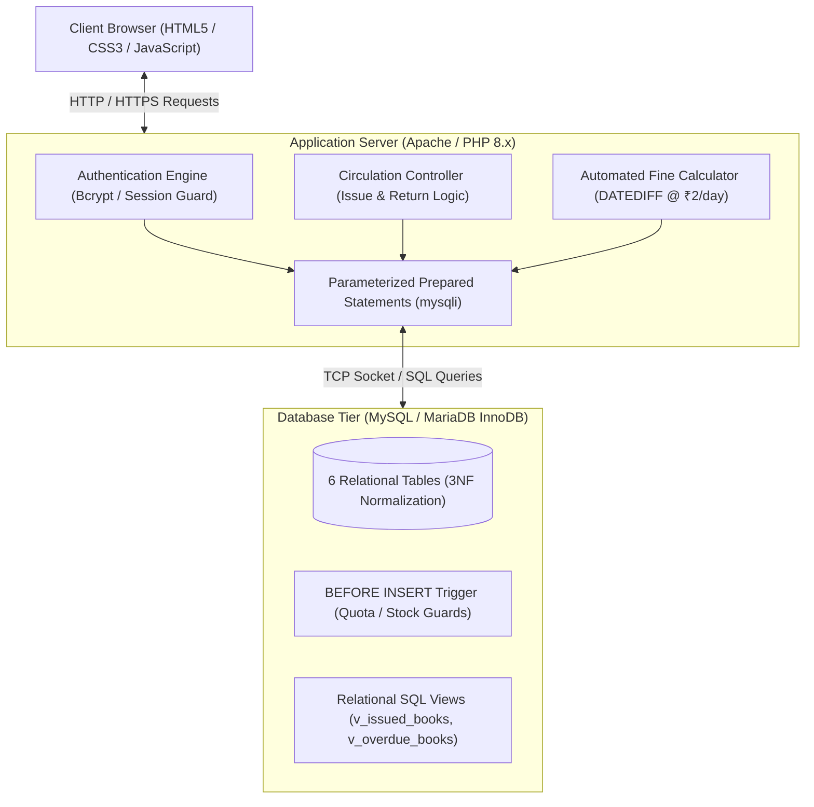
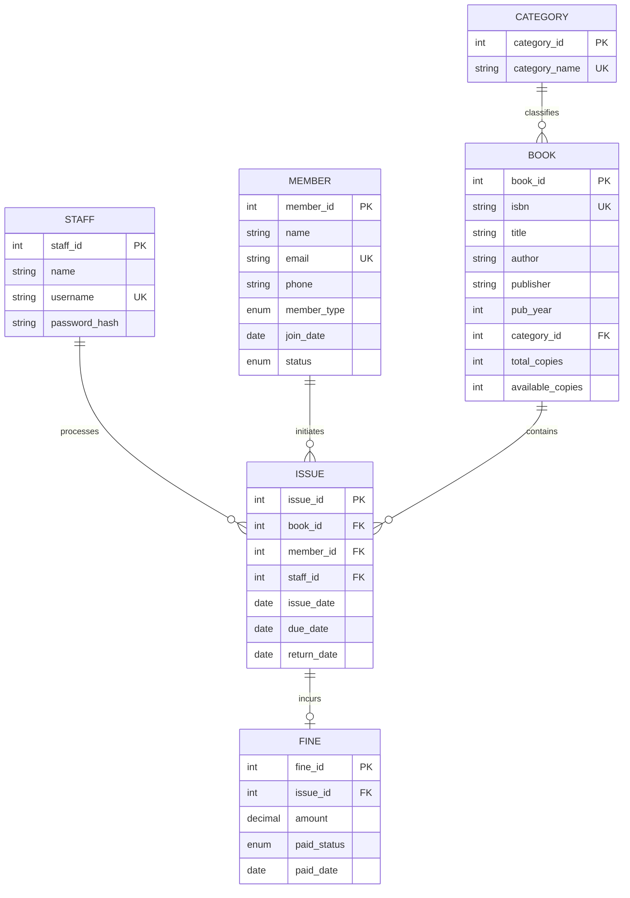

# 📚 College Library Management System (LMS)

[](https://www.php.net/)
[](https://www.mysql.com/)
[](https://www.apachefriends.org/)
[](#-system-architecture)
[](http://kartikeya.infinityfreeapp.com)
[](#-license)

> An ACID-compliant, 3NF-normalized relational database and full-stack web application designed to replace manual paper circulation registers with automated quota enforcement, real-time inventory tracking, and dynamic overdue fine calculations.

---

### 🌐 Live Deployment & Source Code
* **🚀 Production Application:** [http://kartikeya.infinityfreeapp.com](http://kartikeya.infinityfreeapp.com)
* **💻 GitHub Repository:** [https://github.com/kartikm0111/Library-management-](https://github.com/kartikm0111/Library-management-)
* **🔑 Default Staff Credentials:** `admin` / `password`

---

## 📑 Table of Contents
- [Executive Overview](#-executive-overview)
- [System Architecture](#-system-architecture)
- [Relational Database Design & ERD](#-relational-database-design--erd)
- [Database Normalization (3NF Justification)](#-database-normalization-3nf-justification)
- [Key Features & Business Rules](#-key-features--business-rules)
- [Defensive Security Engineering](#-defensive-security-engineering)
- [Analytical SQL Suite (Queries & Views)](#-analytical-sql-suite-queries--views)
- [Repository File Structure](#-repository-file-structure)
- [Installation & Local Setup (XAMPP)](#-installation--local-setup-xampp)
- [Mandatory Test Cases & Verification Matrix](#-mandatory-test-cases--verification-matrix)
- [License](#-license)

---

## 🎯 Executive Overview

In conventional collegiate libraries, circulation is frequently managed through physical logbooks. This introduces operational friction:
1. **Lost & Damaged Ledgers:** Historical borrowing logs degrade and lack redundancy.
2. **Untracked Overdue Loans:** Identifying unreturned books past their 14-day borrowing window requires manual scanning across hundreds of ledger pages.
3. **Manual Fine Computation Errors:** Penalties computed by hand are inconsistent and lack audit trails.

**This Library Management System solves these challenges** by implementing a three-tier architecture that validates business quotas at runtime, tracks inventory atomically, and generates financial fine ledgers upon late returns.

---

## 🏛️ System Architecture



---

## 🗄️ Relational Database Design & ERD

The database schema comprises **6 core normalized entities** maintaining strict referential integrity through foreign keys with `ON DELETE RESTRICT` constraints.



### Relational Schema Summary:
1. **`category`** (`category_id` [PK], `category_name` [UNIQUE])
2. **`book`** (`book_id` [PK], `isbn` [UNIQUE], `title`, `author`, `publisher`, `pub_year`, `category_id` [FK], `total_copies`, `available_copies`)
   - *Constraint:* `CHECK (total_copies >= 0)`, `CHECK (available_copies BETWEEN 0 AND total_copies)`
3. **`member`** (`member_id` [PK], `name`, `email` [UNIQUE], `phone`, `member_type` ['Student', 'Faculty'], `join_date`, `status` ['Active', 'Suspended'])
4. **`staff`** (`staff_id` [PK], `name`, `username` [UNIQUE], `password_hash`)
5. **`issue`** (`issue_id` [PK], `book_id` [FK], `member_id` [FK], `staff_id` [FK], `issue_date`, `due_date`, `return_date`)
   - *Constraint:* `CHECK (due_date >= issue_date)`
6. **`fine`** (`fine_id` [PK], `issue_id` [FK, UNIQUE], `amount`, `paid_status` ['Paid', 'Unpaid'], `paid_date`)

---

## 📐 Database Normalization (3NF Justification)

* **First Normal Form (1NF):** Every field stores atomic values; repeating groups (such as comma-delimited book IDs for borrowed items) are decoupled into the relational `issue` entity.
* **Second Normal Form (2NF):** Every table employs a single-column surrogate primary key (`category_id`, `book_id`, etc.). Hence, partial functional dependencies on composite candidate keys do not exist.
* **Third Normal Form (3NF):** Zero transitive dependencies exist. For example, `category_name` is decoupled from `book` into `category`, preventing the transitive chain `book_id → category_id → category_name`.

### Architectural Note: Flat Author Column vs. M:N Decomposition
To maintain educational scope, author is modeled as a `VARCHAR` attribute in `book`. In enterprise environments, this introduces:
1. **Atomicity Violations:** Multi-authored textbooks (e.g., Cormen, Leiserson, Rivest, Stein) force delimited strings.
2. **Update Anomalies:** Prolific authors require duplicate entries across volumes.
3. **Enterprise Recommendation:** Decompose into `author(author_id, name)` linked via an associative junction table `book_author(book_id, author_id, author_order)`.

---

## ⚡ Key Features & Business Rules

| Business Rule | Implementation Logic | Enforcement Layer |
| :--- | :--- | :--- |
| **Borrowing Quota** | Students: Max **3 books**; Faculty: Max **5 books** | App Script & DB Trigger |
| **Loan Period** | Fixed **14 calendar days** from issue date | Automated Date Arithmetic |
| **Fine Computation** | **₹2.00 per day** overdue after 14 days | Dynamic `DATEDIFF` calculation |
| **Stock Invariant** | Books with `available_copies = 0` cannot be checked out | Atomic Transaction & DB CHECK |
| **Sanction Guard** | Members marked `Suspended` are blocked from new checkouts | Pre-issue Validation |
| **Inventory Sync** | Checkout: `available_copies - 1`; Checkin: `available_copies + 1` | Atomic SQL Transaction |

---

## 🛡️ Defensive Security Engineering

1. **SQL Injection Prevention:** 100% of user inputs passed to MySQL are parameterized using prepared statements (`$stmt = $conn->prepare(...)` followed by `$stmt->bind_param(...)`).
2. **XSS Sanitization:** All dynamic front-end output is escaped using `htmlspecialchars($str, ENT_QUOTES, 'UTF-8')`.
3. **Credential Security:** Passwords are never stored in plaintext; authenticated using PHP `password_hash()` and `password_verify()` via the bcrypt algorithm.
4. **Session Authentication Guard:** All administrative routes invoke `require_login()` to verify active session tokens before rendering restricted components.

---

## 📊 Analytical SQL Suite (Queries & Views)

The project includes 8 verified analytical SQL queries:

1. **Multi-Table JOIN (Active Circulation):** Retrieves unreturned books alongside category name and patron contact details.
2. **Fine Ledger JOIN:** Combines `fine`, `issue`, `member`, and `book` to audit total assessed vs. paid late fees.
3. **GROUP BY Inventory Analysis:** Aggregates titles, total volume counts, and available circulation copies per discipline.
4. **HAVING Clause Filter:** Identifies heavy borrowers holding 2 or more active book issues.
5. **Aggregate Financial Metrics:** Evaluates total fine assessments, realized collections, and outstanding dues.
6. **Correlated Subquery:** Identifies cataloged titles that have never been checked out (`NOT IN (SELECT DISTINCT book_id FROM issue)`).
7. **Date Function (DATEDIFF):** Dynamically computes days overdue and projected penalty amounts.
8. **Nested Subquery (Circulation Peak):** Isolates the most frequently borrowed catalog items.

### Pre-configured Views:
* **`v_issued_books`:** Real-time view of currently borrowed volumes with patron profiles.
* **`v_overdue_books`:** Real-time filtered view of loans past due date with dynamic penalty computations.

---

## 📂 Repository File Structure

```text
Library-management-/
├── config.php            # Centralized database connection, helpers, & session guard
├── header.php            # Modular navigation bar and responsive header
├── footer.php            # Standardized layout footer
├── style.css             # Unified CSS3 stylesheet (modern responsive design)
├── index.php             # Circulation desk dashboard with real-time KPI metrics
├── login.php             # Staff authentication portal (bcrypt verified)
├── logout.php            # Session termination and cleanup
├── books.php             # Book inventory management and search filters
├── members.php           # Patron directory and standing status toggle
├── issue.php             # Book checkout transaction workflow with quota guards
├── return.php            # Book return workflow with automated fine calculation
├── issued.php            # Active loans registry (powered by v_issued_books)
├── overdue.php           # Overdue loans and fine audit (powered by v_overdue_books)
├── fines.php             # Fine payment settlement and accounting ledger
├── schema.sql            # Normalized DDL script (tables, constraints, views, trigger)
├── data.sql              # Seed dataset (exceeds Section 6 minimum quotas)
├── queries.sql           # 8 verified analytical queries with documented outputs
└── README.md             # Technical project documentation
```

---

## 💻 Installation & Local Setup (XAMPP)

### Prerequisites
* [XAMPP](https://www.apachefriends.org/) (Apache 2.4+, PHP 8.x, MySQL/MariaDB)
* Git

### Step-by-Step Installation
1. **Clone the Repository:**
   ```bash
   cd C:\xampp\htdocs
   git clone https://github.com/kartikm0111/Library-management-.git
   ```

2. **Database Initialization:**
   * Start **Apache** and **MySQL** from the XAMPP Control Panel.
   * Open phpMyAdmin: [http://localhost/phpmyadmin](http://localhost/phpmyadmin).
   * Create a database named `library_db` (`utf8mb4_unicode_ci`).
   * Import `schema.sql` first, followed by `data.sql`.

3. **Configure Database Connection:**
   Open `config.php` and verify credentials:
   ```php
   define('DB_HOST', 'localhost');
   define('DB_USER', 'root');
   define('DB_PASS', '');
   define('DB_NAME', 'library_db');
   ```

4. **Launch Application:**
   Navigate to: `http://localhost/Library-management-/`  
   *Default Login:* `admin` / `password`

---

## 🧪 Mandatory Test Cases & Verification Matrix

The seed dataset is pre-configured to facilitate live validation of all Section 10 edge cases in under 2 minutes:

| Test Case | Scenario / Parameters | Expected System Behavior | Result |
| :--- | :--- | :--- | :---: |
| **TC-01** | Student `#1` attempts 4th book issue | System halts transaction: *"Student already holds maximum allowed 3 books"* | ✅ Passed |
| **TC-02** | Check out book `#6` with `available_copies = 0` | System halts transaction: *"Book has 0 available copies in stock"* | ✅ Passed |
| **TC-03** | Member `#5` (`Suspended`) attempts issue | System halts transaction: *"Member is currently SUSPENDED"* | ✅ Passed |
| **TC-04** | Return book 5 days past due date | Generates ₹10.00 fine (`5 days × ₹2.00`) and logs unpaid fine row | ✅ Passed |
| **TC-05** | Return book on time or before due date | Transaction completes with 0 days late; no fine row generated | ✅ Passed |
| **TC-06** | Staff login with incorrect password | Access rejected: *"Invalid username or password"*; session blocked | ✅ Passed |

---

## 📜 License
Distributed under the **MIT License**. Created for academic evaluation and database management systems demonstration.
